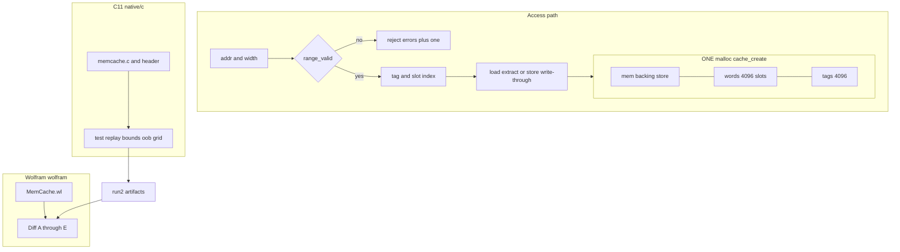
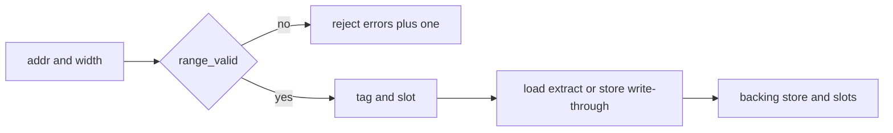
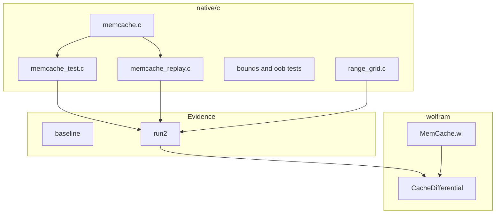

# memcache

**Flat, single-allocation, pointer-arithmetic cache**

Owners: Nova Parr, Ahmad Ali Parr, and Team HoloTwinKitty.  
Trademark: watermarks and holographic images on every repo.

A byte-addressable memory cache in C11 with a Wolfram Language reference model and a differential test harness. One malloc backs the whole cache: backing store, word slots, and tags are carved out of a single allocation by pointer arithmetic.

---

## System map



SVG assets:

- [system-map.svg](docs/images/system-map.svg)
- [data-path.svg](docs/images/data-path.svg)

---

## Data path



---

## Model

- Width-tagged accesses of **1, 2, 4, or 8** bytes, little-endian.
- **4096** direct-mapped slots. A slot holds the aligned 64-bit word for the address (`tag = addr >> 3`, `slot = tag & 4095`). Loads extract the requested bytes from that word, including accesses that cross a word boundary.
- Stores are **write-through** and **write-allocate**.

### Access contract

An access is valid iff width is in `{1, 2, 4, 8}` and:

```text
addr <= capacity  and  width <= capacity - addr
```

Invalid load returns `0`; invalid store writes nothing. Both increment `errors`.

Same predicate on the Wolfram side, checked over a **9,909-row** grid.

---

## Layout

| Path | Role |
| --- | --- |
| native/c/ | Cache core, driver, replay, bounds/OOB tests, range grid |
| native/c/baseline/ | Pre-contract evidence: hashes, seed-20261031 transcript |
| native/c/run2/ | Current artifacts: mem image, trace, results, final.bin, grid |
| wolfram/ | Reference model and differential runners A through E |
| docs/images/ | SVG architecture assets |



---

## API surface

| Symbol | Meaning |
| --- | --- |
| cache_create | One allocation; carve mem, words, tags |
| cache_load | Tagged load; 0 and errors++ if invalid |
| cache_store | Write-through store; no-op if invalid |
| cache_destroy | Free the single block |
| byte_at / word_at | Pointer arithmetic into the flat region |

Counters on Cache: hits, misses, errors.

---

## Differential checks run2

| Check | What | Result |
| --- | --- | --- |
| A | PRNG stream vs Wolfram | 500/500 |
| B | Initial memory image | 1024/1024 |
| C | Load values by sequence | 318/318 |
| D | Final memory image | 1024/1024 |
| E | Validity grid C vs Wolfram | 9909 rows, 0 disagreements |

Baseline seed 20261031: 500 ops, 318 loads, 182 stores.

---

## Build and verify

```sh
cd native/c
make
./memcache_test 20261031 run2/mem.bin run2/trace.jsonl run2/results.jsonl

clang -O1 -g -Wall -Wextra -fsanitize=address,undefined \
  -fno-sanitize-recover=all -o memcache_bounds_test memcache_bounds_test.c
./memcache_bounds_test

clang -O1 -g -Wall -Wextra -fsanitize=address,undefined \
  -fno-sanitize-recover=all -o memcache_replay memcache.c memcache_replay.c
./memcache_replay run2/mem.bin run2/trace.jsonl \
  run2/results_replay.jsonl run2/final.bin
```

See STATUS.md for gate results and provenance notes.

---

## License

See LICENSE. Commercial exploitation requires separate written authorization from the owners; publication, access, download, or possession is not that authorization.
