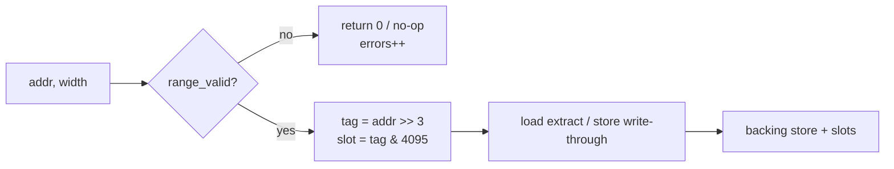
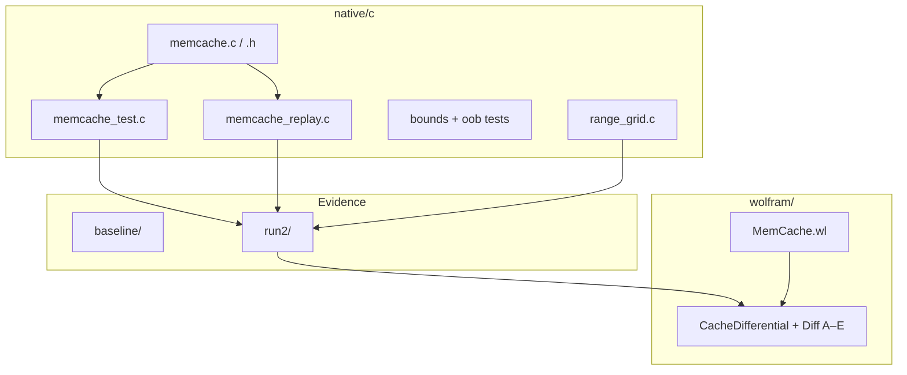

# memcache

**Flat, single-allocation, pointer-arithmetic cache**

Owners: Nova Parr, Ahmad Ali Parr, and Team HoloTwinKitty.  
Trademark: watermarks and holographic images on every repo.

A byte-addressable memory cache in C11 with a Wolfram Language reference model and a differential test harness. One `malloc` backs the whole cache: backing store, word slots, and tags are carved out of a single allocation by pointer arithmetic.

---

## System map


---

## Data path




---

## Model

- Width-tagged accesses of **1, 2, 4, or 8** bytes, little-endian.
- **4096** direct-mapped slots. A slot holds the aligned 64-bit word for the address (`tag = addr >> 3`, `slot = tag & 4095`). Loads extract the requested bytes from that word, including accesses that cross a word boundary.
- Stores are **write-through** and **write-allocate**.

### Access contract

An access is valid iff width is in `{1, 2, 4, 8}` and:

```text
addr <= capacity  and  width <= capacity - addr
```

Invalid load returns `0`; invalid store writes nothing. Both increment `errors` (independent status channel so a rejected load is distinct from a valid zero).

Same predicate on the Wolfram side:

```text
Valid(a, w, M)  iff  0 ≤ a ≤ M  and  0 < w ≤ M − a
```

Equivalence is checked over a **9,909-row** dumped grid.

---

## Layout

| Path | Role |
| --- | --- |
| `native/c/` | Cache core, driver, replay, bounds/OOB tests, range grid |
| `native/c/baseline/` | Pre-contract evidence: hashes, seed-20261031 transcript |
| `native/c/run2/` | Current artifacts: mem image, trace, results, final.bin, grid |
| `wolfram/` | Reference model + differential runners A–E |
| `docs/images/` | Architecture visuals |



---

## API surface

| Symbol | Meaning |
| --- | --- |
| `cache_create(memBytes)` | One allocation; carve mem / words / tags |
| `cache_load(c, addr, width)` | Tagged load; 0 + `errors++` if invalid |
| `cache_store(c, addr, width, val)` | Write-through store; no-op if invalid |
| `cache_destroy(c)` | Free the single block |
| `byte_at` / `word_at` | Pointer arithmetic into the flat region |

Counters on `Cache`: `hits`, `misses`, `errors`.

---

## Differential checks (run2)

| Check | What | Result |
| --- | --- | --- |
| A | PRNG stream vs Wolfram | 500/500 |
| B | Initial memory image | 1024/1024 |
| C | Load values by sequence | 318/318 |
| D | Final memory image | 1024/1024 |
| E | Validity grid C vs Wolfram | 9,909 rows, 0 disagreements |

Baseline seed `20261031`: 500 ops, 318 loads, 182 stores.

---

## Build and verify

```sh
cd native/c
make                                    # clang, ASan + UBSan
./memcache_test 20261031 run2/mem.bin run2/trace.jsonl run2/results.jsonl

clang -O1 -g -Wall -Wextra -fsanitize=address,undefined \
  -fno-sanitize-recover=all -o memcache_bounds_test memcache_bounds_test.c
./memcache_bounds_test                  # 1580+ checks

clang -O1 -g -Wall -Wextra -fsanitize=address,undefined \
  -fno-sanitize-recover=all -o memcache_replay memcache.c memcache_replay.c
./memcache_replay run2/mem.bin run2/trace.jsonl \
  run2/results_replay.jsonl run2/final.bin
```

See `STATUS.md` for gate results and provenance notes.

---

## License

See `LICENSE`. Commercial exploitation requires separate written authorization from the owners; publication, access, download, or possession is not that authorization.
